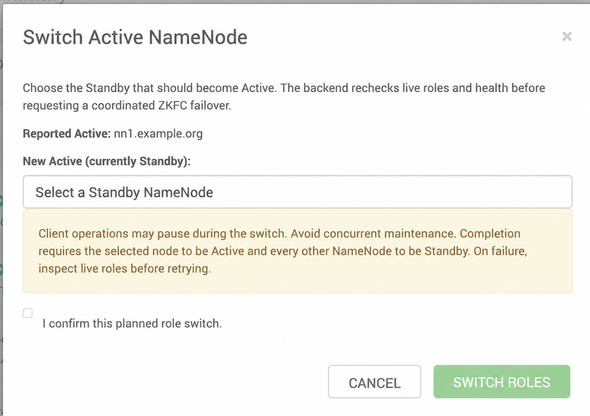

<!--
Licensed to the Apache Software Foundation (ASF) under one
or more contributor license agreements.  See the NOTICE file
distributed with this work for additional information
regarding copyright ownership.  The ASF licenses this file
to you under the Apache License, Version 2.0 (the
"License"); you may not use this file except in compliance
with the License.  You may obtain a copy of the License at

    http://www.apache.org/licenses/LICENSE-2.0

Unless required by applicable law or agreed to in writing, software
distributed under the License is distributed on an "AS IS" BASIS,
WITHOUT WARRANTIES OR CONDITIONS OF ANY KIND, either express or implied.
See the License for the specific language governing permissions and
limitations under the License.
-->

# Switch Active NameNode

HDFS → Service Actions → **Switch Active NameNode** lets an operator select a
reported Standby and confirm a planned, coordinated role switch. The command
runs on the reviewed Active host. Progress and errors appear in Ambari's
background operations; verified before/after roles are included in structured
output.

This contribution targets Apache Ambari `branch-3.0.0`, its Ember UI, and the
BIGTOP HDFS service inherited by BIGTOP 3.3.0. It supports an existing automatic
HA nameservice with two or three NameNodes. Provisioning a third NameNode is
outside this change; the existing stack cardinality is preserved.



The screenshot was supplied from the test cluster; its hostname has been
anonymized to `nn1.example.org` for publication.

## Checks and behavior

- Requires SERVICE.RUN_CUSTOM_COMMAND in UI and the standard Ambari custom
  command API authorization. The component-level generic shortcut is hidden.
- UI requires 2–3 running NN, exactly one reported Active, other NN Standby,
  and running ZKFC on each NN; stale NN/ZKFC configurations block the dialog.
- Reported UI roles are a snapshot. Backend rereads roles through haadmin;
  it rejects an unexpected Active, unknown role, unhealthy source/target,
  a target in another nameservice, or local hdfs-site topology differing from
  the Ambari command configuration.
- Uses hdfs haadmin -ns <ns> -failover <source-id> <target-id> once.
  Uses automatic HA/ZKFC; no force flags or transitionToActive calls.
- Success requires selected target Active and all other configured NN Standby.
- Nonzero exit, timeout or unconfirmed post-state is a failed task. Roles might
  already have changed. Inspect live state before any retry; there is no
  automatic retry of the mutation, reverse failover, kill, format or restart.
- Private temporary Kerberos credentials are removed after the operation.
- A per-nameservice lock on the source agent rejects duplicate local commands.
  This is not a distributed lock against other operators or automatic HA.
  The state preflight is not an atomic compare-and-switch. Avoid concurrent
  maintenance; coordination/fencing correctness still depends on Hadoop/ZKFC.

## Validation

The UI was checked on the test cluster. The operator also confirmed successful
manual testing of role switching on that cluster.

Focused automated checks:

```sh
PYTHONPATH=ambari-server/src/main/resources/stacks/BIGTOP/3.2.0/services/HDFS/package/scripts:ambari-common/src/main/python \
  python3 dev-support/nn-role-switch/test_role_switch.py
node ambari-web/test/standalone/namenode_role_switch_test.js
cd ambari-web && ./node_modules/.bin/brunch build
```

The backend suite covers two/three-node topology, health and role drift,
configuration mismatch, duplicate local operations, timeouts, and confirmation
of the final roles. The UI suite covers target selection, confirmation,
authorization, stale configurations, ZKFC availability, and double submission.

## Operation and recovery

Before switching, reconcile loaded NN/ZKFC configuration and confirm journal,
Kerberos and ZKFC health. Disk XML comparison verifies the CLI configuration;
it does not prove that every running daemon has loaded that configuration.
Do not clear stale flags just to bypass the check.

After an error or timeout, inspect actual roles before retrying. Removing this
feature from Ambari does not reverse an already completed HDFS role switch.

## Reference

[Hadoop 3.3.6 automatic failover documentation](https://hadoop.apache.org/docs/r3.3.6/hadoop-project-dist/hadoop-hdfs/HDFSHighAvailabilityWithQJM.html#Automatic_Failover_FAQ)
describes coordinated `haadmin -failover` with automatic HA enabled.
